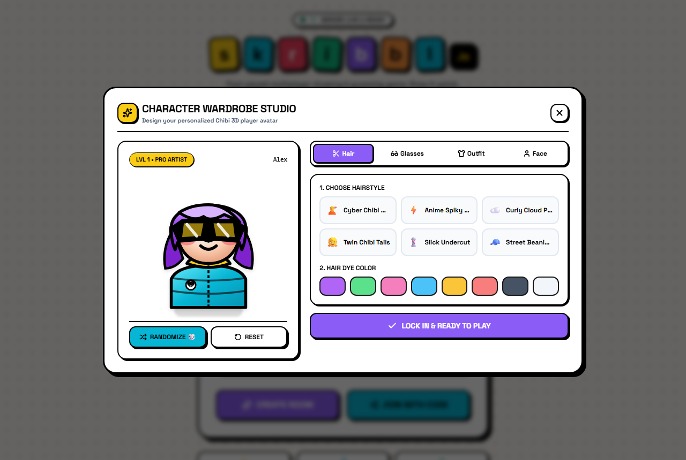
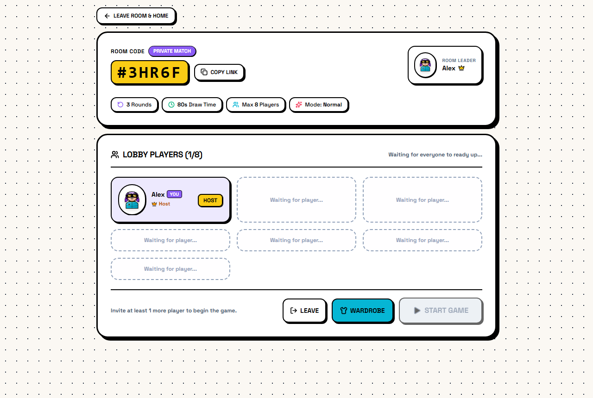

# skribbl.io Clone — Real-Time Multiplayer Drawing & Guessing Game

A full-stack, real-time multiplayer drawing and guessing game inspired by skribbl.io. Built with **React 19, TypeScript, Node.js, Express, and raw WebSockets (`ws`)**.

Designed and engineered for an internship assignment with clean Object-Oriented Architecture, authoritative server state management, and an original Neo-Brutalist / Pop Art aesthetic.

<p align="center">
  
</p>

<p align="center">
  <b>🎨 Live Real-Time Drawing & Guessing • Turn-Based Game Engine • Neo-Brutalist Pop-Art Aesthetic</b>
</p>

---

## 🚀 Live Demo & Health Check

| Service | Endpoint / URL |
|---|---|
| **Production App (Live)** | [https://skribbl-io-clone-ws44.onrender.com](https://skribbl-io-clone-ws44.onrender.com) |
| **Backend Health Check** | [https://skribbl-io-clone-ws44.onrender.com/api/health](https://skribbl-io-clone-ws44.onrender.com/api/health) |
| **WebSocket Stream** | `wss://skribbl-io-clone-ws44.onrender.com/ws` |

---

## 📸 Screenshots & Visual Showcase

| Home Screen & Character Preview | 3D Chibi Wardrobe Studio |
|:---:|:---:|
|  |  |
| *Pop-Art Letter Logo, Live Server Badge & Character Preview* | *Hair Dye, Cyberpunk Eyewear, Outfits & Skin Tones* |

| Match Lobby & Room Settings | Real-Time Canvas & Gameplay |
|:---:|:---:|
|  |  |
| *5-Char Room Code, Copy Link, Leaderboard & Ready Status* | *Sub-30ms Bézier Canvas, 14-Color Swatches & Guess Chat* |

---

## 📚 Project Documentation
Comprehensive architectural and technical specifications are organized in the `docs/` folder:
- **[Architecture Overview](docs/ARCHITECTURE.md):** Domain model, server classes, canvas rendering pipeline, and reconnection architecture.
- **[WebSocket Protocol Specification](docs/PROTOCOL.md):** Full list of client/server message envelopes, payloads, and event schemas.
- **[Game Rules & Scoring](docs/GAME_RULES.md):** Turn progression, Levenshtein distance calculations, hints reveal schedule, and scoring algorithms.
- **[Deployment & Platform Constraints](docs/DEPLOYMENT.md):** Render deployment setup, production builds, and why serverless platforms (Vercel/Netlify) require a separate WebSocket process.
- **[Assignment Requirements Checklist](docs/PROJECT_SPEC.md):** Feature-by-feature verification against the assignment criteria.

---

## ✨ Features

### 1. Room & Lobby Management
- **Public & Private Rooms:** Generate clean, user-friendly 5-character room codes (e.g. `#X44YP`).
- **One-Click Shareable Links:** Copy direct invite links (`/?room=CODE`) with automatic lobby routing and code pre-filling.
- **Lobby Controls:** Real-time ready status, host leader badge indicator, and host game launcher.
- **Host Settings Configuration:**
  - **Rounds:** 2–10
  - **Draw Time:** 15–240 seconds
  - **Max Players:** 2–20
  - **Word Choices:** 1–5 choices per turn
  - **Hints:** 0–5 revealed letters
  - **Word Modes:** Normal, Hidden (masked word for everyone with 1.25x point bonus), Combination (compound words)
  - **Custom Words:** Host-supplied dictionary merged seamlessly with default vocabulary.

### 2. Turn-Based Game Engine & Authoritative Server
- **Pure Object-Oriented Server Architecture:** Modular separation of concerns into `Player`, `Room`, `RoomStore`, `Game`, `WordService`, `GuessMatcher`, and `scoring`.
- **Authoritative State Machine:** Strict transitions (`LOBBY` → `WORD_PICK` → `DRAWING` → `ROUND_END` → `GAME_OVER`).
- **Zero Information Leakage:** Secret words are sent only to the current drawer; guessers receive only length hints and progressively revealed letters.
- **Automated Fallbacks:** Automatic 15-second word picker timer if drawer is inactive, turn skip on disconnect, and graceful game-over handling if fewer than 2 players remain.

### 3. Real-Time Drawing Canvas
- **Normalized Coordinates:** All drawing vectors are normalized to $[0, 1]$ coordinate space, ensuring pixel-perfect canvas parity across any screen resolution and aspect ratio.
- **Sub-30ms Batched Streaming:** Pointer movements are buffered locally and flushed at 30 ms intervals to prevent network congestion while delivering responsive real-time strokes.
- **Smooth Bézier Rendering:** Guesser screens render incoming stroke vectors using midpoint quadratic curves (`quadraticCurveTo`), eliminating jagged line artifacts.
- **Drawer Toolbar:**
  - Freehand brush and eraser tools
  - 14-color palette
  - 4 stroke sizes (S, M, L, XL)
  - Multi-level Undo & full Canvas Clear actions
- **State Restoration:** Late joiners and reconnecting players instantly receive full canvas snapshots (`canvas_sync`).

### 4. Smart Guessing, Hints & Anti-Spoiler Chat
- **Intelligent Text Normalization:** Case-insensitive parsing, diacritic stripping (`é → e`), and punctuation collapsing.
- **Near-Miss Feedback:** Real-time Levenshtein edit-distance calculation sends a private *"So close!"* notification to guessers within 1 edit of the secret word.
- **Anti-Spoiler Containment:** Guesses typed into full sentences (e.g., *"is it a dog?"*) or correct guesses are suppressed from public chat.
- **Guesser Isolation Channel:** Once a player guesses correctly, their chat messages are routed to an exclusive channel visible only to fellow guessers and the drawer, preventing round spoiling.

### 5. Interactive Character & Wardrobe Studio
- **Vector-Based 3D Chibi Avatars:** Fully responsive, zero-lag SVG character system.
- **Wardrobe Customization:**
  - 6 Skin tones
  - 6 Hairstyles with 8 vibrant hair colors
  - 5 Expressive eye styles
  - 7 Eyewear accessories (Cyberpunk visor, retro sunglasses, round frames, etc.)
  - 5 Outfits with 8 color variants
- **Dice Randomizer & Reset:** Quick random generation or factory reset.
- **Real-Time Sync:** Outfits sync instantly to the server and update player cards and game leaderboards.

### 6. In-Game Moderation & Player Profiles
- **skribbl.io Style Profile Modal:** Click any player in the Lobby or in-game Leaderboard to open their profile.
- **Host Kick:** Instant removal of disruptive players.
- **Democratic VoteKick:** Non-hosts can vote to kick players; triggers automatic ejection upon reaching majority consensus ($> 50\%$).
- **Client-Side Mute:** Toggle chat muting for specific players locally.
- **Kudos / Reactions:** Send celebratory thumbs-up feedback.

### 7. Resilience & Session Recovery
- **Dual-Tier Seat Holding & Lobby Retention:** Disconnected players in active games retain their seat and score for 60 seconds; lobby rooms are preserved for 10 minutes so hosts can switch apps (e.g. WhatsApp) to invite friends without losing the room.
- **Smart Link & Hash Routing:** Robust URL parameter and hash parser (`/?room=CODE`, `/#CODE`) with automatic session conflict isolation.
- **Session Tokens:** `localStorage` token preservation enables seamless state, score, and canvas recovery on page refresh.

---

## 🛠️ Tech Stack

| Layer | Technologies | Purpose |
|---|---|---|
| **Frontend** | React 19, TypeScript, Vite, Tailwind CSS v4, Zustand, Lucide React, Canvas-Confetti | Responsive UI, canvas rendering, state store, pop-art design |
| **Backend** | Node.js 20+, TypeScript, Express, native `ws` (WebSockets) | HTTP API, WebSocket server, game room management |
| **Protocol** | JSON `{ type: string, payload: object }` over `/ws` | Lightweight, bidirectional real-time event pipeline |
| **Styling** | Neo-Brutalism & Pop Art design system | Space Grotesk typography, 3px bold borders, offset shadows |
| **Storage** | In-memory `RoomStore` behind an extensible interface | Zero external database dependency, swappable for Redis |

---

## 🏗️ System & Network Architecture

The application is engineered with an **authoritative server domain model** and a **reactive single-page client**. All critical game rules, secret word isolation, turn timers, and scoring are validated strictly by the backend.

```text
Browser (React 19 + Canvas + Zustand)
       │
       │  Single persistent WebSocket (/ws)
       │  Bidirectional JSON Envelope: { type, payload }
       ▼
Node.js + Express + ws Server
 ├── MessageRouter (Auth, validation, routing)
 ├── RoomStore (In-memory room registry, swappable for Redis)
 └── Room (Player session tracking, broadcast channels)
      └── Game (Authoritative state machine)
           ├── WordService (Dictionary, combination modes, no repeats)
           ├── GuessMatcher (Unicode normalizer, Levenshtein edit distance)
           ├── StrokeBuffer (Ordered stroke vector history for undo & late join)
           └── scoring (Time, order bonus, and streak multiplier algorithms)
```

### Real-Time Drawing & Guessing Event Flow

```text
DRAWER CLIENT                    WEBSOCKET SERVER                   GUESSER CLIENTS
     │                                  │                                  │
     │── [Pointer Down / Move] ─────────┼──────────────────────────────────┤
     │   (Local optimistic render: 0ms) │                                  │
     │                                  │                                  │
     │── draw_move (30ms batch) ───────▶│                                  │
     │                                  ├── Appends to StrokeBuffer        │
     │                                  │                                  │
     │                                  ├── draw_data (broadcast) ────────▶│
     │                                  │   (Suppress echo to drawer)      ├── Render Bézier curve
     │                                  │                                  │
     │                                  │◀── guess: "dog" ─────────────────┤
     │                                  ├── GuessMatcher.classify()        │
     │                                  │   ├─ Check exact match           │
     │                                  │   └─ Levenshtein distance 1      │
     │                                  │                                  │
     │◀── guess_result (+pts) ──────────┼── guess_result (+pts) ──────────▶│
     │    (Update scoreboard)           │   (Green banner, mask revealed)  │
```

### Authoritative Game State Machine

```text
LOBBY ──start_game──▶ WORD_PICK ──word_chosen / 15s timeout──▶ DRAWING
  ▲                       ▲                                       │
  │                       │            all guessed OR time up     ▼
  │                       └──── next drawer ◀──────────────── ROUND_END
  │                                                               │ last drawer of last round
  └──────────── play_again (host) ◀──────────────────────── GAME_OVER
```

> 📖 **Deep Dive Documentation Links:**
> - Detailed server domain classes, canvas rendering pipeline & reconnect lifecycles: **[docs/ARCHITECTURE.md](docs/ARCHITECTURE.md)**
> - Complete catalog of typed client/server WebSocket message schemas: **[docs/PROTOCOL.md](docs/PROTOCOL.md)**
> - Turn progression, Levenshtein distance & scoring formulas: **[docs/GAME_RULES.md](docs/GAME_RULES.md)**
> - Production deployment setup & serverless (Vercel/Netlify) constraints: **[docs/DEPLOYMENT.md](docs/DEPLOYMENT.md)**
> - Full assignment requirements compliance checklist: **[docs/PROJECT_SPEC.md](docs/PROJECT_SPEC.md)**

---

## 📁 Project Directory Structure

```text
skribbl-clone/
├── client/                     # Frontend Application (React 19 + TypeScript + Vite)
│   ├── public/                 # Static assets & public images
│   │   ├── doodle-pattern.svg  # Cream background dot-grid pattern
│   │   └── screenshots/        # High-resolution application screenshots
│   ├── src/
│   │   ├── components/         # Reusable UI component library
│   │   │   ├── Avatar.tsx              # Modular 3D Chibi SVG avatar system
│   │   │   ├── AvatarCustomizer.tsx    # Quick avatar customizer & dice randomizer
│   │   │   ├── Canvas.tsx              # HTML5 Canvas with normalized [0, 1] coords
│   │   │   ├── CharacterStudio.tsx     # Full Wardrobe Studio modal
│   │   │   ├── Chat.tsx                # Chat & guess box with mute filtering
│   │   │   ├── GameOver.tsx            # Podium celebration with canvas confetti
│   │   │   ├── GameTimer.tsx           # Masked word hint tiles & animated countdown
│   │   │   ├── Leaderboard.tsx         # Player rankings, scores, medals & drawer icon
│   │   │   ├── PlayerProfileModal.tsx  # skribbl.io profile modal (kick/votekick/mute)
│   │   │   └── Toolbar.tsx             # Brush, eraser, 14 swatches, sizes, undo/clear
│   │   ├── net/
│   │   │   └── socket.ts       # Typed WebSocket wrapper with token reconnect & outbound queue
│   │   ├── utils/
│   │   │   └── invite.ts       # Robust invite URL & hash code extraction helper
│   │   ├── screens/            # Application views
│   │   │   ├── Home.tsx        # Landing view with nickname & avatar spotlight
│   │   │   ├── CreateRoom.tsx  # Match settings panel (rounds, drawTime, modes)
│   │   │   ├── JoinRoom.tsx    # Room code join form with URL pre-fill
│   │   │   ├── Lobby.tsx       # Pre-game room with player cards & ready toggles
│   │   │   └── Game.tsx        # Active 3-column gameplay layout
│   │   ├── store/
│   │   │   └── useGame.ts      # Global Zustand state store
│   │   ├── types/
│   │   │   └── index.ts        # Shared TypeScript interfaces & types
│   │   ├── index.css           # Neo-Brutalist & Pop-Art utility classes
│   │   ├── App.tsx             # Root screen router & URL param handler
│   │   └── main.tsx            # Vite entry point
│   └── package.json
│
├── server/                     # Backend Application (Node.js 20+ Express + ws)
│   ├── src/
│   │   ├── words/
│   │   │   └── words.json      # Categorized dictionary (8+ categories, 300+ words)
│   │   ├── Game.ts             # Authoritative turn & round state machine
│   │   ├── GuessMatcher.ts     # Unicode normalization & Levenshtein distance 1
│   │   ├── MessageRouter.ts    # WebSocket message dispatcher & authentication
│   │   ├── Player.ts           # Player domain entity with reconnect tokens
│   │   ├── Room.ts             # Room domain entity, broadcasts & host management
│   │   ├── RoomStore.ts        # In-memory room repository (swappable for Redis)
│   │   ├── StrokeBuffer.ts     # Canvas stroke history for late joiners & undo
│   │   ├── WordService.ts      # Word picker with no-repeat tracking & combination mode
│   │   ├── index.ts            # Express server, /api/health, static SPA fallback, /ws
│   │   ├── scoring.ts          # Pure scoring functions (speed, order, streak bonus)
│   │   ├── timing.ts           # Scaled timer helper (supports fast automated tests)
│   │   └── types.ts            # Server schemas, defaults & payload clamping
│   ├── test/                   # Automated unit test suite (15/15 tests passing)
│   ├── smoke.mjs               # Quick integration sanity test script
│   ├── test-game.mjs           # Full multi-client end-to-end simulation script
│   └── package.json
│
├── docs/                       # Technical Specifications & Documentation
│   ├── ARCHITECTURE.md         # Full system design, classes, & reconnect lifecycle
│   ├── PROTOCOL.md             # Complete typed WebSocket event schemas
│   ├── GAME_RULES.md           # Game mechanics, hint timelines & scoring algorithms
│   ├── DEPLOYMENT.md           # Production deployment guide & platform constraints
│   ├── PROJECT_SPEC.md         # Requirements checklist mapped to assignment criteria
│   └── screenshots/            # High-res screenshots of all game screens
│
├── .gitignore                  # Production gitignore
├── package.json                # Root orchestration package.json
└── README.md                   # Main project documentation

---

## 💻 Local Setup & Running

### Prerequisites
- Node.js 20 or higher
- npm 9 or higher

### Quick Start (Single Command)
```bash
# 1. Install all dependencies (server & client)
npm run install:all

# 2. Build client and server
npm run build

# 3. Start unified production server (serves React client and WebSockets on :3001)
npm start
```
Open your browser and navigate to **http://localhost:3001**.

### Development Mode (Concurrent Terminals)
```bash
# Terminal 1: Backend WebSocket Server (port 3001)
npm run dev:server

# Terminal 2: Frontend Vite Dev Server with HMR (port 5173)
npm run dev:client
```
Open **http://localhost:5173**. Vite proxies `/ws` connections directly to the backend.

### Run Automated Tests
```bash
# Unit tests (GuessMatcher, scoring, StrokeBuffer)
npm test

# Full multi-client integration simulation (run with TIME_SCALE=0.1)
cd server && TIME_SCALE=0.1 npm run dev
# In another terminal:
node server/test-game.mjs
```

---

## 🎮 How to Play
1. **Enter Nickname & Style Avatar:** Choose your display name and customize your 3D Chibi avatar in the Wardrobe Studio.
2. **Create or Join a Room:** Host a private/public room or join using a 5-character room code (`#ABCDE`) or invite link.
3. **Lobby & Ready Up:** Once all players toggle their ready status, the host starts the game.
4. **Draw & Guess:** Each round, one player draws their chosen secret word while others guess in real-time chat.
5. **Score Points:** Guessers earn points based on speed, streak, and order bonuses. The drawer earns points when others guess correctly.
6. **Victory & Podium:** Complete all rounds to crown the champion on the podium with confetti celebrations!
