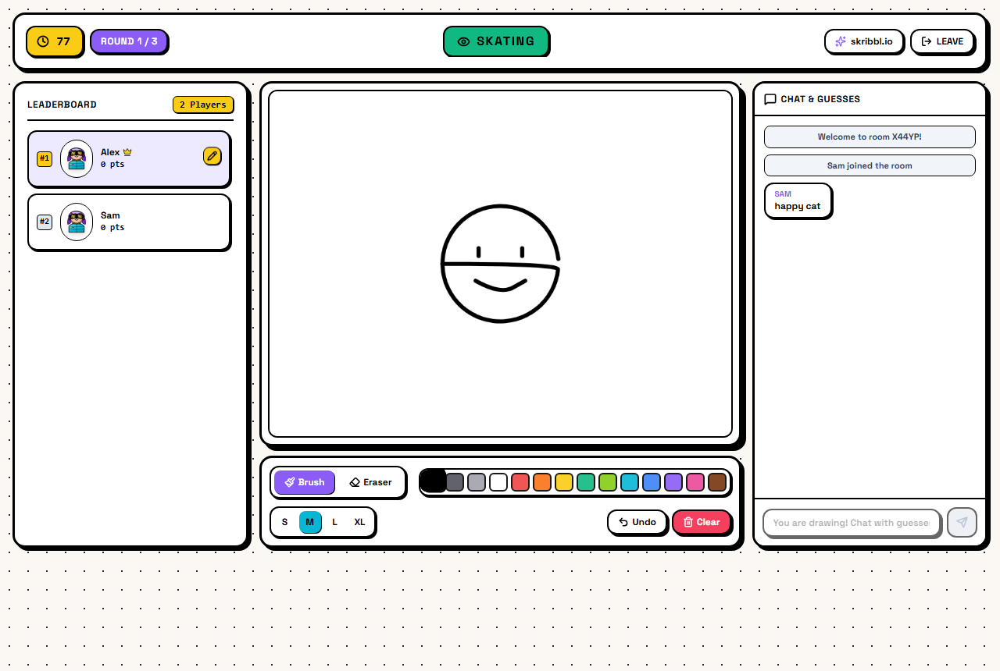
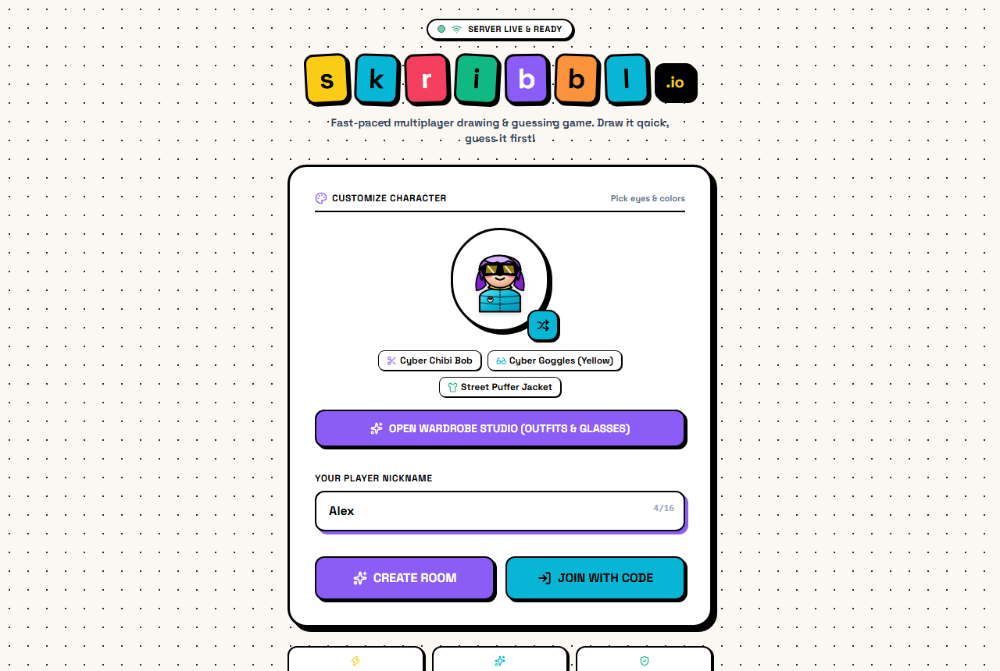

# skribbl.io Clone — Real-Time Multiplayer Drawing & Guessing Game

A full-stack, real-time multiplayer drawing and guessing game inspired by skribbl.io. Built with **React 19, TypeScript, Node.js, Express, and raw WebSockets (`ws`)**.

Designed and engineered for an internship assignment with clean Object-Oriented Architecture, authoritative server state management, and an original Neo-Brutalist / Pop Art aesthetic.

<p align="center">
  
</p>

<p align="center">
  <b>🎨 Live Real-Time Drawing & Guessing • Turn-Based Game Engine • Neo-Brutalist Pop-Art Aesthetic</b>
</p>

---

## 🚀 Live Demo & Health Check

| Service | Endpoint / URL |
|---|---|
| **Production App** | `https://your-deployment-url.onrender.com` *(Set upon deployment)* |
| **Backend Health Check** | `/api/health` |
| **WebSocket Stream** | `/ws` (Native WebSockets) |

---

## 📸 Screenshots & Visual Showcase

| Home Screen & Character Preview | 3D Chibi Wardrobe Studio |
|:---:|:---:|
|  |  |
| *Pop-Art Letter Logo, Live Server Badge & Character Preview* | *Hair Dye, Cyberpunk Eyewear, Outfits & Skin Tones* |

| Match Lobby & Room Settings | Real-Time Canvas & Gameplay |
|:---:|:---:|
|  |  |
| *5-Char Room Code, Copy Link, Leaderboard & Ready Status* | *Sub-30ms Bézier Canvas, 14-Color Swatches & Guess Chat* |

---

## 📚 Project Documentation
Comprehensive architectural and technical specifications are organized in the `docs/` folder:
- **[Architecture Overview](docs/ARCHITECTURE.md):** Domain model, server classes, canvas rendering pipeline, and reconnection architecture.
- **[WebSocket Protocol Specification](docs/PROTOCOL.md):** Full list of client/server message envelopes, payloads, and event schemas.
- **[Game Rules & Scoring](docs/GAME_RULES.md):** Turn progression, Levenshtein distance calculations, hints reveal schedule, and scoring algorithms.
- **[Deployment & Platform Constraints](docs/DEPLOYMENT.md):** Render deployment setup, production builds, and why serverless platforms (Vercel/Netlify) require a separate WebSocket process.
- **[Assignment Requirements Checklist](docs/PROJECT_SPEC.md):** Feature-by-feature verification against the assignment criteria.

---

## ✨ Features

### 1. Room & Lobby Management
- **Public & Private Rooms:** Generate clean, user-friendly 5-character room codes (e.g. `#X44YP`).
- **One-Click Shareable Links:** Copy direct invite links (`/?room=CODE`) with automatic lobby routing and code pre-filling.
- **Lobby Controls:** Real-time ready status, host leader badge indicator, and host game launcher.
- **Host Settings Configuration:**
  - **Rounds:** 2–10
  - **Draw Time:** 15–240 seconds
  - **Max Players:** 2–20
  - **Word Choices:** 1–5 choices per turn
  - **Hints:** 0–5 revealed letters
  - **Word Modes:** Normal, Hidden (masked word for everyone with 1.25x point bonus), Combination (compound words)
  - **Custom Words:** Host-supplied dictionary merged seamlessly with default vocabulary.

### 2. Turn-Based Game Engine & Authoritative Server
- **Pure Object-Oriented Server Architecture:** Modular separation of concerns into `Player`, `Room`, `RoomStore`, `Game`, `WordService`, `GuessMatcher`, and `scoring`.
- **Authoritative State Machine:** Strict transitions (`LOBBY` → `WORD_PICK` → `DRAWING` → `ROUND_END` → `GAME_OVER`).
- **Zero Information Leakage:** Secret words are sent only to the current drawer; guessers receive only length hints and progressively revealed letters.
- **Automated Fallbacks:** Automatic 15-second word picker timer if drawer is inactive, turn skip on disconnect, and graceful game-over handling if fewer than 2 players remain.

### 3. Real-Time Drawing Canvas
- **Normalized Coordinates:** All drawing vectors are normalized to $[0, 1]$ coordinate space, ensuring pixel-perfect canvas parity across any screen resolution and aspect ratio.
- **Sub-30ms Batched Streaming:** Pointer movements are buffered locally and flushed at 30 ms intervals to prevent network congestion while delivering responsive real-time strokes.
- **Smooth Bézier Rendering:** Guesser screens render incoming stroke vectors using midpoint quadratic curves (`quadraticCurveTo`), eliminating jagged line artifacts.
- **Drawer Toolbar:**
  - Freehand brush and eraser tools
  - 14-color palette
  - 4 stroke sizes (S, M, L, XL)
  - Multi-level Undo & full Canvas Clear actions
- **State Restoration:** Late joiners and reconnecting players instantly receive full canvas snapshots (`canvas_sync`).

### 4. Smart Guessing, Hints & Anti-Spoiler Chat
- **Intelligent Text Normalization:** Case-insensitive parsing, diacritic stripping (`é → e`), and punctuation collapsing.
- **Near-Miss Feedback:** Real-time Levenshtein edit-distance calculation sends a private *"So close!"* notification to guessers within 1 edit of the secret word.
- **Anti-Spoiler Containment:** Guesses typed into full sentences (e.g., *"is it a dog?"*) or correct guesses are suppressed from public chat.
- **Guesser Isolation Channel:** Once a player guesses correctly, their chat messages are routed to an exclusive channel visible only to fellow guessers and the drawer, preventing round spoiling.

### 5. Interactive Character & Wardrobe Studio
- **Vector-Based 3D Chibi Avatars:** Fully responsive, zero-lag SVG character system.
- **Wardrobe Customization:**
  - 6 Skin tones
  - 6 Hairstyles with 8 vibrant hair colors
  - 5 Expressive eye styles
  - 7 Eyewear accessories (Cyberpunk visor, retro sunglasses, round frames, etc.)
  - 5 Outfits with 8 color variants
- **Dice Randomizer & Reset:** Quick random generation or factory reset.
- **Real-Time Sync:** Outfits sync instantly to the server and update player cards and game leaderboards.

### 6. In-Game Moderation & Player Profiles
- **skribbl.io Style Profile Modal:** Click any player in the Lobby or in-game Leaderboard to open their profile.
- **Host Kick:** Instant removal of disruptive players.
- **Democratic VoteKick:** Non-hosts can vote to kick players; triggers automatic ejection upon reaching majority consensus ($> 50\%$).
- **Client-Side Mute:** Toggle chat muting for specific players locally.
- **Kudos / Reactions:** Send celebratory thumbs-up feedback.

### 7. Resilience & Session Recovery
- **30-Second Seat Holding:** Disconnected players retain their seat and score during a grace period.
- **Session Tokens:** `localStorage` token preservation enables seamless state, score, and canvas recovery on page refresh.

---

## 🛠️ Tech Stack

| Layer | Technologies | Purpose |
|---|---|---|
| **Frontend** | React 19, TypeScript, Vite, Tailwind CSS v4, Zustand, Lucide React, Canvas-Confetti | Responsive UI, canvas rendering, state store, pop-art design |
| **Backend** | Node.js 20+, TypeScript, Express, native `ws` (WebSockets) | HTTP API, WebSocket server, game room management |
| **Protocol** | JSON `{ type: string, payload: object }` over `/ws` | Lightweight, bidirectional real-time event pipeline |
| **Styling** | Neo-Brutalism & Pop Art design system | Space Grotesk typography, 3px bold borders, offset shadows |
| **Storage** | In-memory `RoomStore` behind an extensible interface | Zero external database dependency, swappable for Redis |

---

## 💻 Local Setup & Running

### Prerequisites
- Node.js 20 or higher
- npm 9 or higher

### Quick Start (Single Command)
```bash
# 1. Install all dependencies (server & client)
npm run install:all

# 2. Build client and server
npm run build

# 3. Start unified production server (serves React client and WebSockets on :3001)
npm start
```
Open your browser and navigate to **http://localhost:3001**.

### Development Mode (Concurrent Terminals)
```bash
# Terminal 1: Backend WebSocket Server (port 3001)
npm run dev:server

# Terminal 2: Frontend Vite Dev Server with HMR (port 5173)
npm run dev:client
```
Open **http://localhost:5173**. Vite proxies `/ws` connections directly to the backend.

### Run Automated Tests
```bash
# Unit tests (GuessMatcher, scoring, StrokeBuffer)
npm test

# Full multi-client integration simulation (run with TIME_SCALE=0.1)
cd server && TIME_SCALE=0.1 npm run dev
# In another terminal:
node server/test-game.mjs
```

---

## 🎓 Code Walkthrough Preparation

### 1. How are drawing strokes captured, batched, sent, and rendered?
- **Capture:** On `pointerdown`, coordinates are normalized to $[0, 1]$ via `(clientX - rect.left) / rect.width`. The drawer draws directly to their local canvas immediately for zero perceptible lag, and dispatches `draw_start`.
- **Batching:** Consecutive `pointermove` events push points into an array throttled to 30 ms intervals and transmitted as `draw_move`.
- **Rendering:** Guessers receive `draw_data` and connect points using quadratic Bézier curves (`quadraticCurveTo`) calculated through segment midpoints, ensuring fluid lines across all client frame rates.

### 2. How does the server manage game state, turn order, and scoring?
- `Game.ts` maintains an authoritative state machine: `LOBBY` $\to$ `WORD_PICK` $\to$ `DRAWING` $\to$ `ROUND_END` $\to$ `GAME_OVER`.
- Turn order is established by snapshotting connected players at game launch. Total game turns equal $\text{rounds} \times \text{players}$.
- **Turn Termination:** A turn concludes when all guessers guess the word (`all_guessed`), the countdown timer expires (`time_up`), or the drawer disconnects (`drawer_left`).
- **Scoring Formula:** Guessers earn points based on time remaining, order bonus (first guesser receives the highest multiplier), and streak bonuses. The drawer receives points proportional to the number of players who guessed their drawing.

### 3. How are WebSockets used for real-time synchronization?
- A single persistent `/ws` connection per client transmits typed messages using an envelope format: `{ "type": string, "payload": object }`.
- `MessageRouter` validates message payloads, authentication tokens, sender roles (drawer vs. guesser vs. host), and active phase before modifying server state and broadcasting to target room participants.
- The server does not echo drawing data back to the drawer, saving outbound bandwidth and avoiding double-rendering.

### 4. How does word-matching logic work? What qualifies as "close"?
- Both the player's guess and the secret word undergo Unicode normalization, diacritic removal (`café` $\to$ `cafe`), lowercase conversion, and punctuation collapsing.
- If the normalized string matches, the guess is scored as **correct**.
- If the Levenshtein edit distance between the guess and the target word is exactly 1 (for words with $\ge 4$ characters), it is classified as **close**. The server emits a private `close_guess` notification exclusively to that guesser.

### 5. How do session recovery and reconnects work?
- Upon entering a room, the server issues a cryptographically random `token` stored in `localStorage`.
- If a client temporarily disconnects, a 30-second seat-holding grace timer is initiated.
- Upon reconnecting, the client sends `rejoin { roomCode, token }`. The server validates the token, re-attaches the WebSocket connection, cancels the grace timer, and pushes the latest `game_state` and complete `canvas_sync` history.

### 6. Why can't serverless platforms (Vercel/Netlify) host the WebSocket server?
- Vercel and Netlify functions are serverless and ephemeral: instances terminate shortly after HTTP request completion and cannot maintain persistent TCP connections.
- WebSockets require a continuous, stateful bi-directional socket connection. Therefore, the server is hosted on long-lived platforms like Render or Railway.

### 7. How would you scale this architecture horizontally?
- The current implementation encapsulates all room states inside an in-memory `RoomStore`.
- To scale horizontally across multiple Node.js instances:
  1. Back `RoomStore` with Redis for distributed room state storage.
  2. Implement Redis Pub/Sub to broadcast events across server instances.
  3. Configure sticky sessions on the load balancer so each client's WebSocket connection stays pinned to a specific server pod.
